# CircuitSetup Energy Analyzer

A Home Assistant integration for understanding circuit and appliance behavior: what is running, where energy goes, and what has changed from normal.

Built for the [CircuitSetup Expandable 6 Channel ESP32 Energy Meter](https://circuitsetup.us/index.php/product/expandable-6-channel-esp32-energy-meter/) with [ESPHome ATM90E32 sensors](https://esphome.io/components/sensor/atm90e32/). Other compatible meters work when their Home Assistant entities expose usable electrical measurements.

- Track appliance activity, cycles, energy, cost, and standby consumption.
- Review changes against learned baselines, with weather and water-use context.
- Check circuit loading, phase balance, measurement consistency, and unmonitored mains power.
- Review alerts with graphs and feedback, or explore experimental load separation (NILM).

Use Home Assistant's Energy Dashboard for long-term energy accounting and this integration for appliance behavior and circuit diagnostics. Findings are inspection prompts, not fault diagnoses or electrical safety checks.

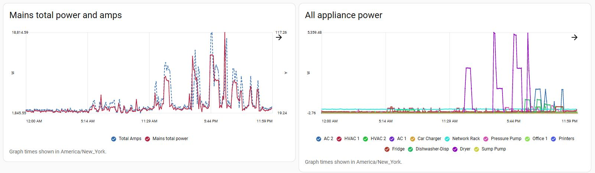

[Installation](#installation) · [Setup](#setup) · [Dashboard](#dashboard) · [Features](#features) · [Load separation](#experimental-load-separation-nilm) · [Alerts](#alerts-and-feedback) · [Troubleshooting](#troubleshooting)

## What you can use it for

Use this integration when you want answers like:

- Is this appliance running, idle, on standby, or not showing recent activity?
- Is today's energy use unusually high for this circuit?
- Is my refrigerator, washer, dryer, pump, HVAC, water heater, or EV charger behaving differently from its learned baseline?
- Is a 240 V appliance balanced across both legs?
- Are watts, amps, volts, VA, and power factor internally consistent?
- Is a circuit approaching a configured breaker or capacity limit?
- Which monitored circuits explain my mains power, and how much power is still unmonitored?
- Is solar being exported, self-consumed, or available for flexible loads?
- Do my measured kWh totals roughly agree with utility or Opower data?
- Are there recurring unknown whole-home load signatures worth investigating?

## Installation

**Requirements:** Home Assistant **2025.1.0+** and meter entities already available in Home Assistant. Real power in W or kW is enough for activity and derived energy tracking. Native cumulative kWh, current, voltage, power factor, reactive power, and apparent power add evidence for the checks that use them.

[](https://my.home-assistant.io/redirect/hacs_repository/?owner=CircuitSetup&repository=CircuitSetup-Energy-Analyzer&category=integration)

| Home Assistant version | Install through |
|---|---|
| **2026.11+** | **Settings > Marketplace**. Search for CircuitSetup Energy Analyzer, or use **Add from link** with this repository's URL. Install and follow setup; complete any restart repair first. |
| **2025.1–2026.10** | **HACS**. Add this repository as an **Integration** custom repository if needed, install, and restart Home Assistant. |

Repository URL: `https://github.com/CircuitSetup/CircuitSetup-Energy-Analyzer`

If setup does not open automatically, go to **Settings > Devices & services > Add integration > CircuitSetup Energy Analyzer**.

Upgrading to Home Assistant 2026.11 migrates existing HACS installations to Marketplace automatically. You do not need to reinstall the analyzer. See the [Marketplace migration guidance](https://www.home-assistant.io/integrations/marketplace/#coming-from-hacs).

For manual installation, copy `custom_components/circuitsetup_energy_analyzer` into your Home Assistant `config/custom_components/` directory, restart, and add the integration.

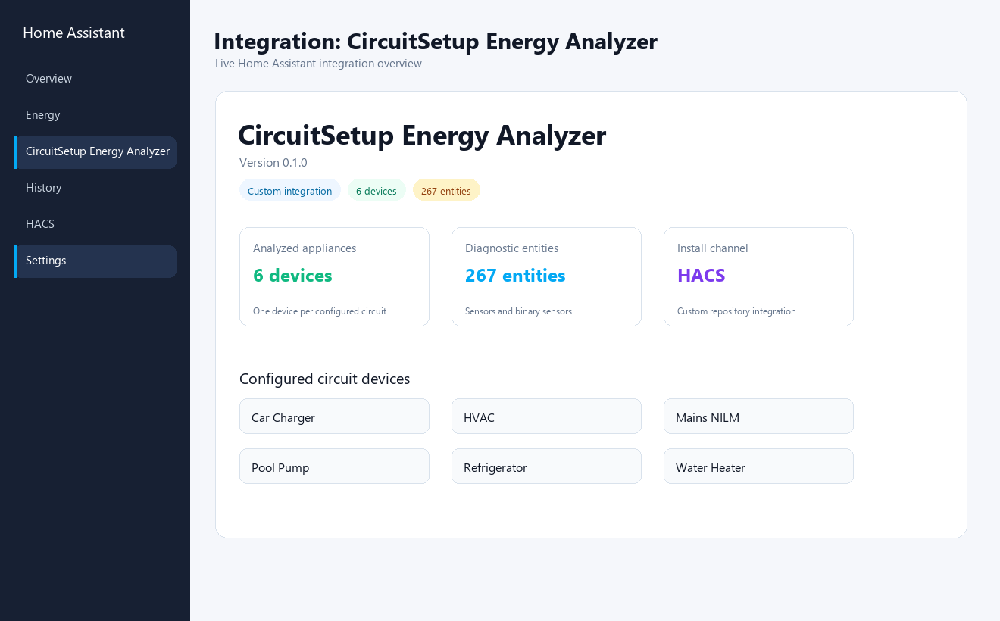

## Setup

Normal setup and tuning use the Home Assistant UI; no YAML or JSON editing is required.

1. Select your meter under **Source Devices**. Use **Extra Source Entities** for individual sensors outside that device selection.
2. Add **Mains Source Entities** only for whole-panel measurements. Mains enable balance, solar, utility comparison, and optional mains NILM.
3. Add any environmental sources you want to use; the table below explains each one.
4. Review **Appliance Circuit Assignments**: confirm each name, appliance type, and matching source sensors. The analyzer suggests a type from entity IDs and friendly names, then derives circuit mode and power-flow mode.
5. Save, check **Setup Health**, and let the analyzer learn. Configure optional checks later under **Advanced Circuit Settings**.

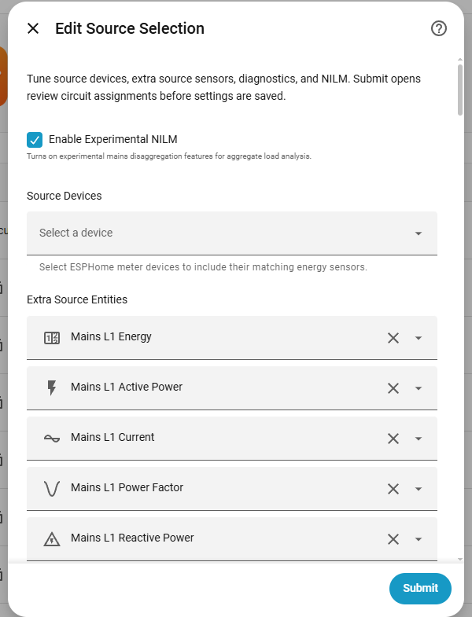

### Assign circuits correctly

Group both legs of a 240 V appliance into one assignment. Each source sensor can belong to only one appliance; unassigned sensors remain available for later use. **Remove From Analysis** returns an appliance's sources to the picker.

| Circuit mode | Use for |
|---|---|
| **Single Phase** | One appliance on one measured leg. |
| **Dual Phase** | Both measured legs of one 240 V appliance. |
| **Mixed** | Several loads on one measured circuit. Select **This circuit also powers unrelated loads** when there is a primary appliance. Mixed dual-phase circuits are not supported. |
| **Mains NILM** | Whole-home mains or feed measurements. Detection remains opt-in. |

Mixed circuits report whole-circuit usage and electrical evidence. They suppress direct appliance-specific alerts, baselines, and recommendations; use reviewed NILM assignments for separated appliance estimates.

Power-flow mode is also derived during assignment: **Load** for consumption, **Generation / Solar Export** for solar, and **Mains / Net** for signed whole-home power. Persistent negative watts on a normal load warrant checking CT orientation and mapping.

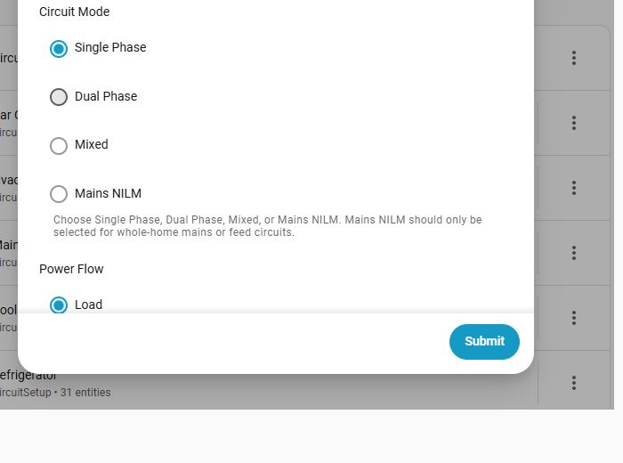

**Available profiles:** refrigerator, freezer, HVAC, HVAC compressor, heat pump, mini-split, HVAC blower, electric heat, water heater, oven, microwave, dishwasher, 3D printer, washer, dryer, pool pump, water pump, well pump, sump pump, EV charger, solar inverter, motor load, resistive load, mixed, and mains NILM.

Use separate compressor and blower profiles when separately metered; use heat pump for equipment that heats and cools with refrigerant. Generic HVAC remains available for combined systems. Explicit `gas_dryer` names default to single phase; `electric_dryer` names default to dual phase.

### Optional context sources

| Source | Enables |
|---|---|
| Outdoor temperature sensor or weather entity | Weather-adjusted HVAC runtime. Humidity, when available, also supports sump-pump condensate context. |
| Thermostat climate entities | Heating/cooling response trends. Link each served zone in the appliance's advanced settings; optional indoor-temperature mappings override the thermostat reading. |
| Binary rain sensor or weather entity | Rain/pump correlation; an optional precipitation-rate sensor adds rain intensity. |
| Binary water-flow or numeric flow-rate sensors | Water-use correlation for washers, dishwashers, water heaters, well pumps, and water pumps. Numeric flow is active above zero. |
| Utility/Opower energy and cost entities | Comparison with measured mains energy and an optional derived electricity rate. |

Unconfigured context is disabled, not treated as evidence that no rain or water use occurred. Global flow sources are shared across compatible appliances; explicitly linked flow sources stay scoped to their appliance.

After adding or renaming meter sensors, use **Configure > Refresh Source Sensors**. It preserves other settings and asks you to review affected assignments when old sources are missing.

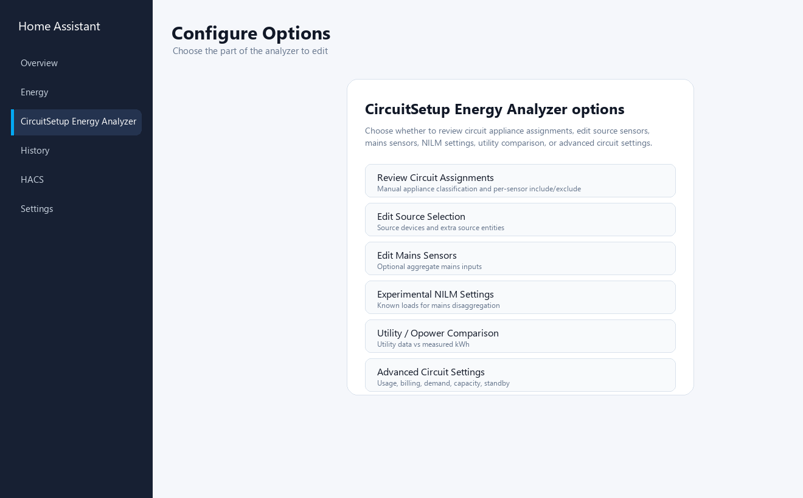

## Dashboard

Open **Configure > Create Or Update Dashboard** and choose a layout:

| Layout | Views |
|---|---|
| **Simple** | Home and Energy & Costs. |
| **Standard** | Simple plus Insights for available mains, NILM, and context features. |
| **Expert** | Standard plus diagnostic navigation in Insights. |

Select **Match Entity Detail Level To Layout** if the chosen layout needs additional entities. **Remove Existing Dashboard** removes the generated dashboard. Run the create/update action again after an upgrade to refresh an older layout.

The dashboard uses the current entity registry, so renamed entities are respected. Its cards ship with the integration and require no third-party Lovelace dependencies.

- **Home:** mains watts/amps, combined appliance power, household energy, searchable appliance tiles, energy/cost rankings, and Running history. Both legs of a dual-phase appliance appear as one power series. Without mains, totals are labeled as monitored load.
- **Energy & Costs:** available context graphs, HVAC & Thermostats, and published NILM appliance power.
- **Insights:** mains coverage, NILM review, contextual summaries, billing-cycle totals, and selected Expert diagnostics. Empty optional views are omitted.

Use the shared date control to move between periods, compare the preceding equal-length range, or download CSV. Graphs have tooltips, double-click zoom, and a History arrow that opens the displayed range in Home Assistant History.

For a custom dashboard, see the [example YAML](docs/dashboard-example.yaml).

### Summary entities

Start with these entities; `<circuit>` is your configured circuit ID. Availability depends on sources and settings.

| Friendly name | Entity pattern | Purpose |
|---|---|---|
| Setup Health / Next Step | `sensor.circuitsetup_energy_analyzer_setup_health` | The next setup or data-quality action. |
| Health Summary | `sensor.<circuit>_health_summary` | Ready, learning, missing data, maintenance, or possible issue. |
| Activity Summary | `sensor.<circuit>_activity_summary` | Running, idle, standby, or off; includes `is_running` for automations. |
| Energy Summary | `sensor.<circuit>_energy_summary` | Usage, goals, billing, cost, and high-usage evidence. |
| Energy Usage Today | `sensor.<circuit>_daily_energy_usage` | Today's kWh from native energy or the automatic watt-to-kWh helper. |
| Cost Today | `sensor.<circuit>_cost_today` | Recorded or estimated daily cost, when available. |
| Average kWh per Day | `sensor.<circuit>_average_kwh_per_day` | Average across up to seven completed days. |
| Average Cost per Day | `sensor.<circuit>_average_cost_per_day` | Completed-day cost average, when available. |

**Entity Detail Level** controls the entity set: **Simple** exposes summaries and daily controls; **Standard** adds configured feature entities; **Expert** adds only the diagnostic groups you select under **Expert Entity Groups**. Existing manual entity-registry choices are respected. See the [compact entity model](docs/entity-model.md).

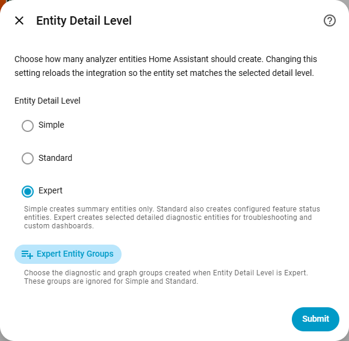

## Appliance detail

Open an appliance tile or **Appliance Insights** to inspect a circuit. Insights lists direct-meter and NILM appliances together, with running, attention, learning, NILM, and data-problem filters.

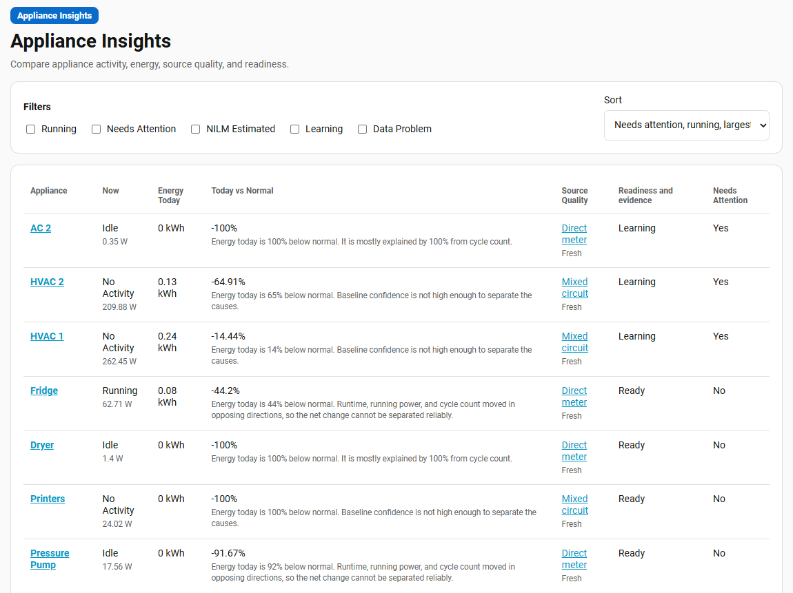

**Appliance Detail** brings together:

- Alert evidence and source watts/amps history, with 24-hour, 7-day, and 30-day ranges.
- **Today vs Normal**, comparing energy, runtime, run count, cost, and demand at the same point in the local day. Projections and completed-day normal ranges are labeled separately.
- **Why Energy Changed**, showing supported runtime, running-power, and cycle-count contributions; unsupported differences remain unexplained.
- Applicable health, cycle, standby, HVAC, and water-context evidence.

Direct measurements and **Estimated by NILM** values are labeled separately. Low-confidence NILM asks for review; it does not establish an appliance fault.

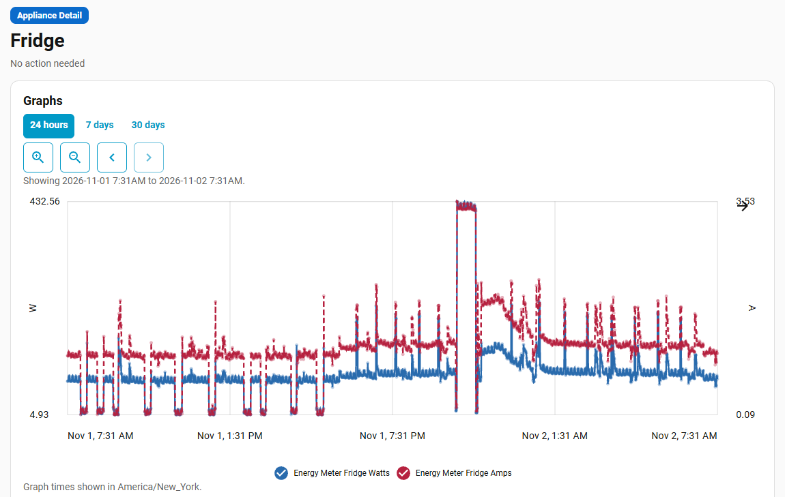

## Features

Enable and tune features under **Configure > Advanced Circuit Settings**. The form only shows settings that apply to the selected circuit. Sensitivity presets are **Quiet**, **Balanced**, and **Sensitive**.

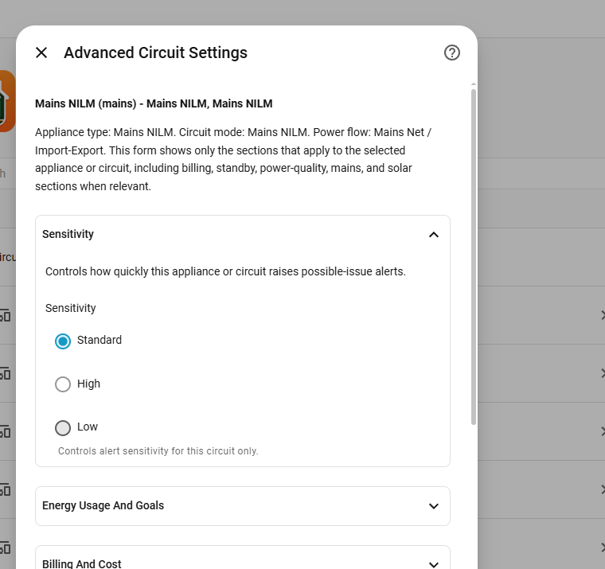

### Energy, goals, and cost

| Feature | What it does |
|---|---|
| Usage spikes | Compares daily kWh with learned history and requires repeated high-usage evidence. |
| Daily goals | Tracks a per-circuit kWh target; set the goal to `0` to clear it. |
| Billing cycle | Tracks current-cycle usage and forecasts against a configured budget. |
| Cost and Time-of-Use | Records cost using shared rates and peak periods, in Home Assistant's configured currency. |
| Utility / Opower comparison | Compares utility kWh with measured mains kWh over the same period. |

Power-only circuits derive kWh from consecutive real-power samples. A native cumulative kWh source is still needed for the setup's Energy Dashboard readiness check.

Set shared base and Time-of-Use rates, peak times, weekdays, and label on the **CircuitSetup Energy Analyzer** device. Set appliance budgets and cycle start days in advanced settings. Configure utility sources under **Configure > Utility / Opower Comparison**; use a Recorder Statistic ID only when no matching entity exists.

The **Electricity Rate** sensor prefers the current valid Opower-derived rate, then the last known valid rate, then the configured base rate. Recorded costs are used when complete. With Time-of-Use and insufficient interval coverage, ambiguous whole-day estimates remain unavailable. Estimates omit taxes, fixed fees, and other utility billing rules; delayed utility data can temporarily disagree with meter data.

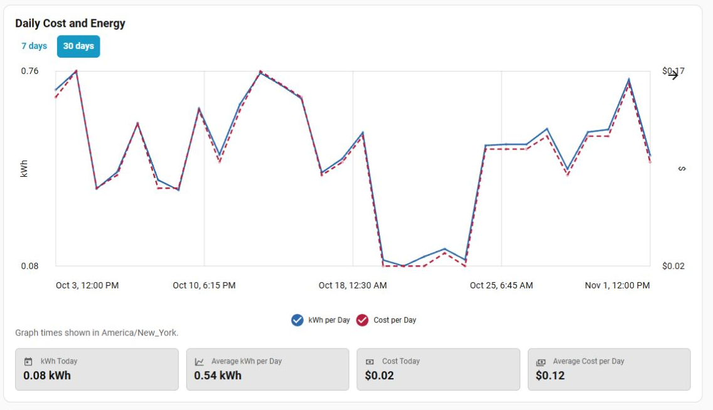

### Appliance behavior and health

Cycle tracking measures starts, runtime, duty cycle, and current activity. Standby analysis estimates the low-power **Always On** load and classifies off/standby/on states.

Predictive health looks for sustained changes in energy per runtime hour or completed cycle, cycle duration, and starts per runtime hour. Its daily comparison needs fourteen comparable reference days plus three recent days. Short-cycle checks also require learned completed sessions. Maintenance-affected evidence is excluded; missing comparable context keeps the result in **Learning**.

Direct-meter refrigerators and freezers with watts, amps, and power factor can also learn a repeating compressor signature and flag persistently changed operation. These findings suggest inspection, not a particular failed part.

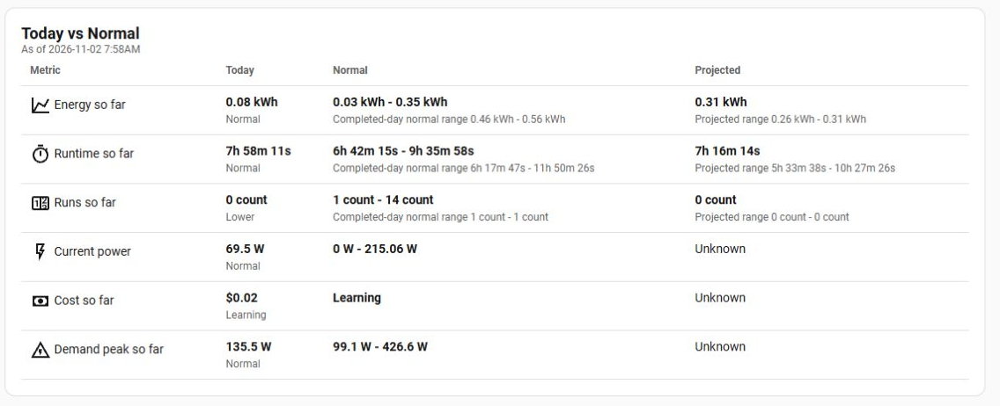

### HVAC, rain, and water

- **HVAC weather context** compares runtime with similar outdoor conditions, learning from at least three distinct prior local dates. Mini-split operation can remain below default running thresholds; adjust these for your equipment when needed.
- **Thermostat response** learns heating and cooling separately from completed eligible days. Link served thermostats in advanced settings; with several thermostats, map zones explicitly. The response score is `100 × expected runtime / recent runtime`: 100 matches normal, lower is slower. Standard/Diagnostic learning needs 50 reference core days plus five recent core days before notifications; Lightweight uses 12 plus five. Coverage and comparable weather/equipment requirements also apply. This is a field-performance trend, not a COP or efficiency rating. A blower represents gas-furnace heating only when explicitly configured; cooling belongs to the compressor or combined system.
- **Rain and pump correlation** accounts for rainfall and, for sump pumps, compressor/humidity condensate context. It needs ten dry, compressor-free context samples. It does not create a missing-pump alert simply because the pump has not run during rain. **Pump Drivers Over Time** aligns completed sump-pump cycles with rain and HVAC history; timing correlations do not establish causes.
- **Water-flow correlation** looks for unexplained flow or appliance activity without expected flow. It needs ten retained context samples. Shared sources can be explained by another mapped appliance; water heaters can use recent flow because heating may follow a draw. No configured flow source means **Unconfigured**, not a mismatch.

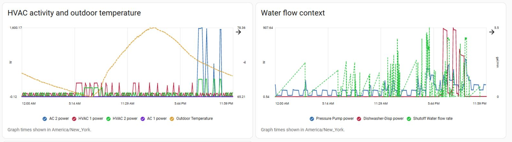

### Electrical, mains, and solar

| Check | Inputs and interpretation |
|---|---|
| Demand | Rolling average watts and today's peak; configure a window and optional limit. |
| Capacity | Current, or watts plus voltage, compared with a configured circuit rating. |
| Dual-phase leg balance | Both legs' real power while a 240 V appliance is drawing meaningful power. |
| Metric consistency and power-quality drift | Available W, A, V, VA, VAR, and power factor; helps identify mapping, calibration, stale-source, or behavior changes. |
| Mains balance | Mains minus monitored loads. Positive residual is often unmonitored load; a large negative residual warrants checking direction, pairing, solar, and double counting. |
| Solar flow | Signed mains/net power plus solar generation: import/export, consumption, self-consumption, surplus, and flexible-load hints. Read-only; control loads through your own automations. |

Capacity diagnostics are operational evidence only. They do not verify breaker, wire, plug, appliance, or code suitability.

Voltage and frequency provide shared mains context. Do not treat apparent power (VA), reactive power (VAR), or harmonic active power as ordinary appliance watts. Automatic assignment leaves harmonic and `total` sensors unassigned for review.

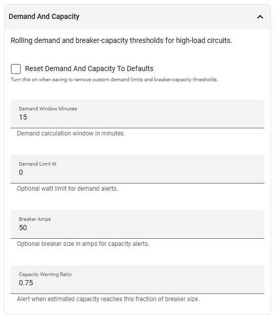

## Experimental load separation (NILM)

NILM estimates individual loads from aggregate real power. Enable it only for the sources you want to review:

- Whole-home mains.
- A mixed circuit with **Several loads with no primary**.
- **A primary appliance plus other loads**.

Open **Load Separation**, or **Review NILM Assignments** from the dashboard's **Mains and NILM** card.

1. Review recurring detections in **Needs Review**. Select a card to focus its completed occurrence on the graph.
2. Assign a signature/session, or drag across the graph and choose **Label appliance interval**. For primary-plus-mixed sources, **Confirm primary appliance** preserves the configured appliance identity.
3. Validate completed sessions or link **Reference sensors**. Review confidence, false-positive/false-negative rates, and power/energy errors when available.
4. Publish only trustworthy assignments to create estimated Home Assistant appliances. Use **Remove HA Device** to stop publication; removed assignments can be restored for review.

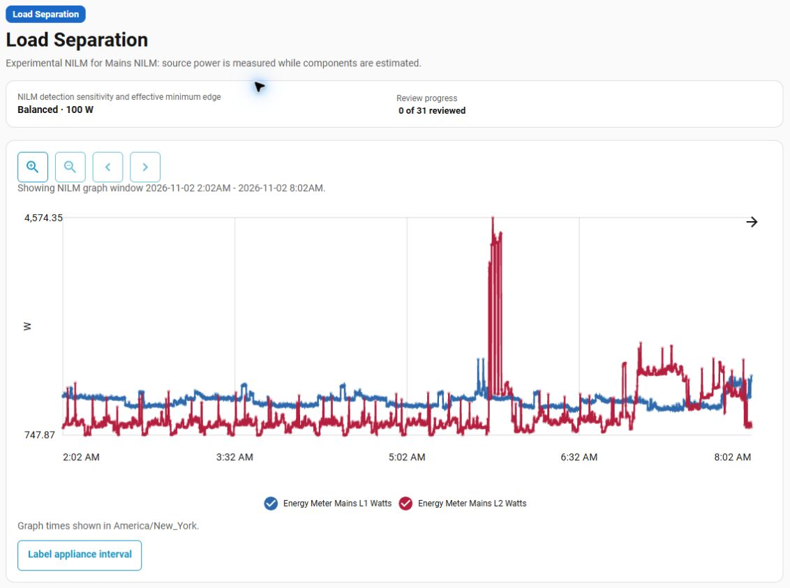

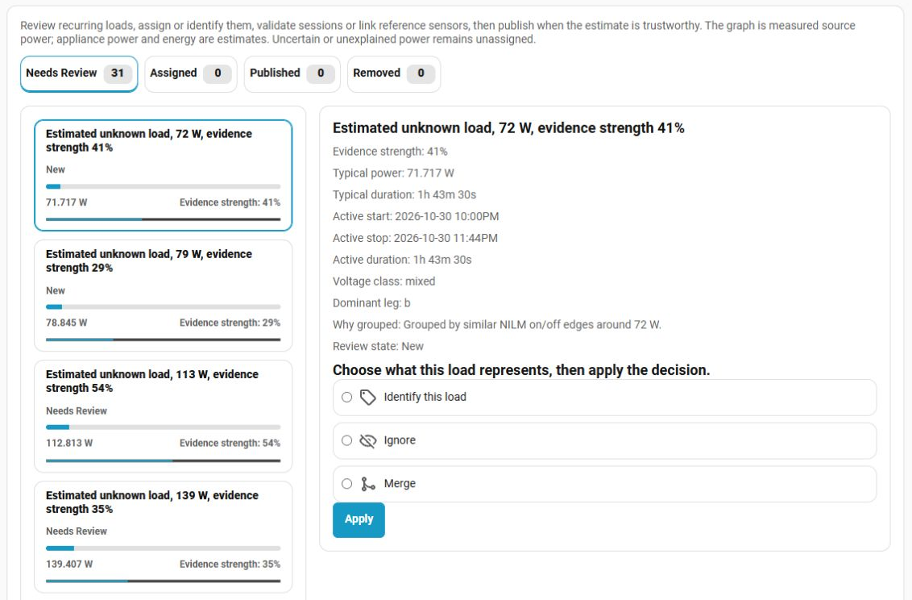

The graph shows measured source watts; separated power and energy are estimates. Open sessions are provisional, overlapping loads may remain ambiguous, and unexplained energy stays unassigned. Supporting VA, VAR, current, and power factor improve matching without being counted as watts. Known-load masking and overlays apply only to mains; helper circuits are corroborating evidence, not subtraction meters or component owners.

A linked `switch`, `binary_sensor`, or `input_boolean` can provide authoritative on/off state while available. A linked real-power sensor supplies validation evidence without replacing NILM energy. **Link and Import History** and **Refresh Reference History** import recorder-backed intervals without duplicating them.

Interval edits remain unsaved until **Save** or **Save Changes**; **Cancel** discards the draft. **Expected** keeps a reviewed load in the model without publishing it. After restart, component state waits for fresh source evidence. NILM estimates are not safety or control evidence.

## Alerts and feedback

**Activity Summary** describes current operation. An observation records unusual evidence; **Possible issue** means repeated evidence crossed an alert threshold. Learning, source quality, and NILM confidence remain separate.

When an alert appears:

1. Select **Open evidence** in the notification. **Alert Evidence** shows the observed/expected comparison, history graph, explanation, and technical details.
2. Check source availability, units, CT direction, phase pairing, and appliance assignment before investigating the appliance.
3. Choose a response in the evidence panel and select **Apply**.

| Response | Effect |
|---|---|
| Acknowledge | Clears the current episode; a later recurrence can alert again. |
| Expected | Remembers the matching pattern for about 90 days. |
| Confirmed issue | Retains your assessment; affected HVAC response episodes are excluded from learning. |
| Not helpful | Requires more repeated matching evidence for about 45 days. |

Native persistent notifications clear when their evidence is no longer current. Per-appliance preferences control delivery and categories; lifecycle updates such as learning or recovery are off by default. Companion App notifications can open the same view using the alert's `evidence_path` for `data.url` and Android `data.clickAction`.

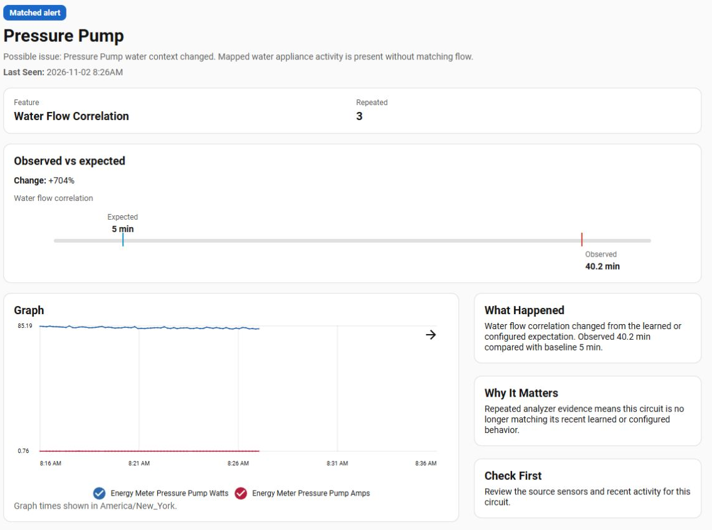

**Weekly Appliance Digest** is opt-in from Setup Health. It separates top energy users, changes from each appliance's normal, unresolved alerts, and historical observations. Week-over-week rankings require two full eligible seven-day weeks. Delivery can stay in the panel or use persistent/mobile notifications.

### Suggested settings

Open **Configure > Review Suggested Settings**. Suggestions show the current/default/proposed values, units, reasons, and evidence; supported thresholds can preview historical impact. Changes are applied only when you approve them.

**Apply Suggestion** and **Dismiss For Now** suppress that setting for 30 days; **Deny Suggestion** suppresses it for 90 days. Applied changes have undo/reset paths. The optional `sensor.<circuit>_settings_suggestions` exposes a bounded preview of up to five pending suggestions.

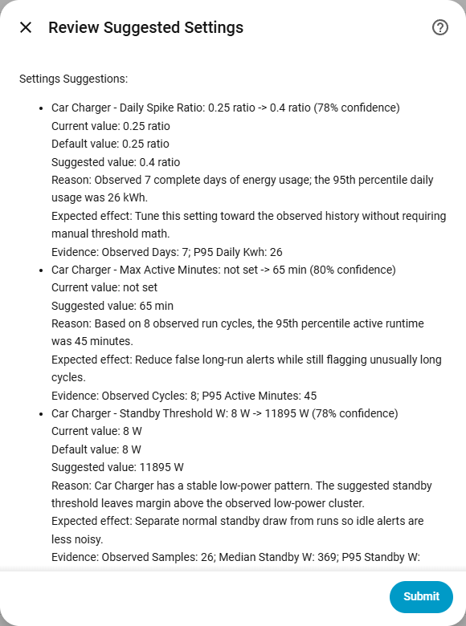

## Controls and automations

Use circuit controls for everyday changes:

| Control | Entity |
|---|---|
| Relearn baseline | `button.<circuit>_relearn_baseline` |
| Alert sensitivity | `select.<circuit>_alert_sensitivity` |
| Daily kWh goal | `number.<circuit>_daily_energy_goal` |
| Pause alerts / maintenance | `switch.<circuit>_maintenance` |

Maintenance keeps telemetry and totals visible while pausing appliance notifications and excluding affected evidence from learning. Relearn after appliance replacement or CT remapping; it starts fresh learning while retaining history.

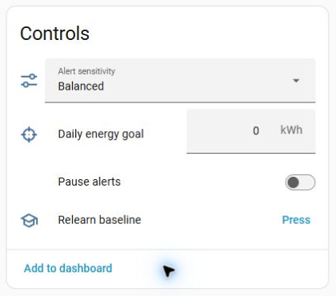

For a washer-finished automation, use Activity Summary's `is_running` attribute. Replace the example entity and notification target with your own:

```yaml
alias: Washer finished
trigger:
  - platform: state
    entity_id: sensor.washer_activity_summary
    attribute: is_running
    from: true
    to: false
    for: "00:03:00"
action:
  - service: notify.mobile_app_phone
    data:
      message: Washer cycle appears finished.
```

For custom alert notifications or follow-up actions, import the [alert automation blueprint](blueprints/automation/circuitsetup_energy_analyzer/energy_alert_notification.yaml). It uses summary evidence, waits until learning finishes, and stays quiet during maintenance. Its additional persistent notification defaults off to avoid duplicates. User-authored blueprint actions run independently of the integration's native delivery preferences.

Advanced actions are available in **Developer Tools > Actions** under `circuitsetup_energy_analyzer`; see the [action definitions](custom_components/circuitsetup_energy_analyzer/services.yaml) for fields. Use an analyzer entity target where supported, or the configured `circuit_id`. Actions include maintenance, relearning, alert feedback, settings, NILM review, mapping checks, diagnostic export, and retained-history CSV export.

Successful actions emit `circuitsetup_energy_analyzer_<action>`, with two shortened completion events:

| Action | Completion event |
|---|---|
| `generate_nilm_sensor_label_intervals` | `circuitsetup_energy_analyzer_generate_nilm_label_intervals` |
| `convert_nilm_appliance_to_direct_meter` | `circuitsetup_energy_analyzer_convert_nilm_to_direct_meter` |

## Learning and retained data

Most behavior checks need at least seven days or enough completed cycles. Health and thermostat-response models need more comparable history; **Learning** can persist when weather, maintenance, or missing sources make days ineligible.

The analyzer retains compact local evidence separately from Home Assistant Recorder:

| Retention mode | Evidence window |
|---|---:|
| Lightweight | 18 days |
| Standard | 45 days |
| Diagnostic | 180 days |

Additional caps bound alert history, feedback, suggestions, context samples, and NILM inventories. Recorder history still determines what is available to history graphs and reference imports. Retention does not replace Home Assistant backups or the Energy Dashboard.

## Troubleshooting

Start with **Setup Health** and Home Assistant **Repairs**. Read the relevant entity's `status_explanation`, source IDs, sample counts, and timestamps before changing thresholds.

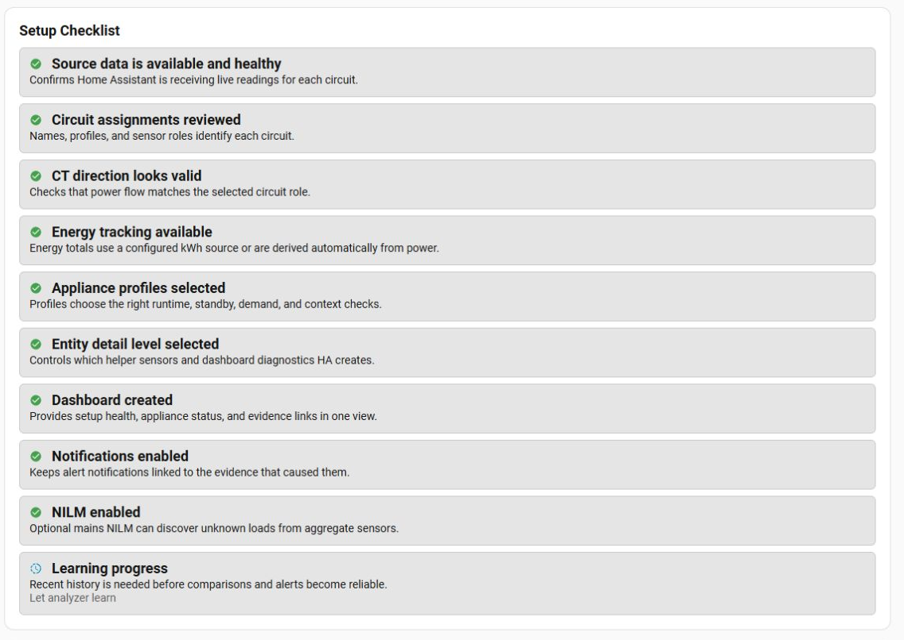

| State or symptom | What to check |
|---|---|
| **Needs data** | Missing, stale, unavailable, or incorrectly mapped sources. |
| **Learning** | Retained days/cycles and comparable context; do not enable every diagnostic entity to fix this. |
| **Waiting For Energy Change** (`waiting_for_delta`) | The first positive native kWh delta or enough consecutive watts samples. A zero daily total can mean waiting, not true zero usage. |
| **Missing Metrics** (`missing_metrics`) | Optional inputs required for that check. |
| `not_dual_phase` / `missing_mains` | The check does not apply to the current topology or has no mains source. |
| Negative load watts / `inconsistent_export` | CT direction, phase mapping, and derived power-flow mode. |
| `no_match` | Utility data may cover a different period or arrive late. |
| `projected_over_budget` | The current projection exceeds the configured billing budget. |
| `active_solar_supported` | Available solar surplus can support the configured flexible load. |

For status-based automations, prefer `raw_status` where exposed rather than a translated display label.

Report problems through [GitHub issues](https://github.com/CircuitSetup/CircuitSetup-Energy-Analyzer/issues), with the integration/HA versions, affected circuit, and relevant diagnostics. Review exports for private information before sharing.
